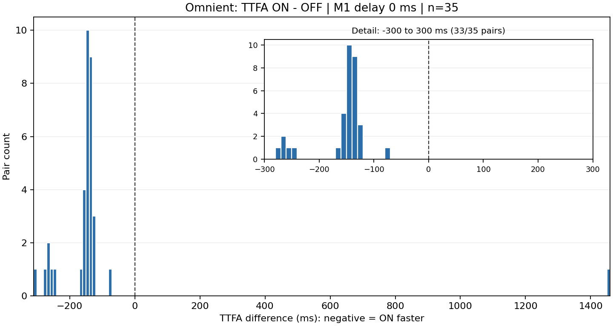
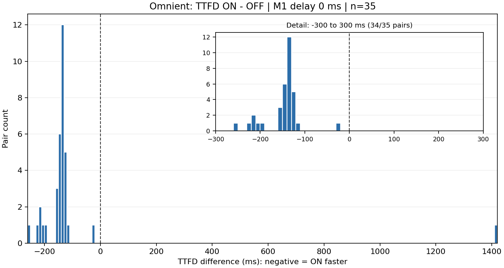
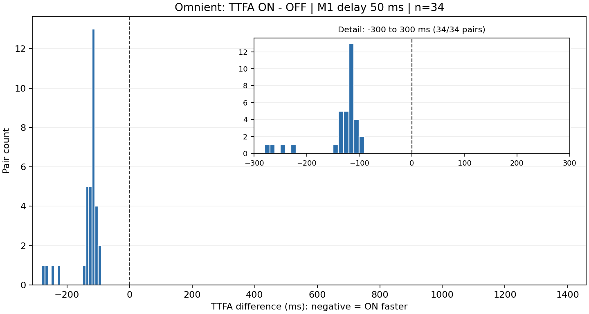
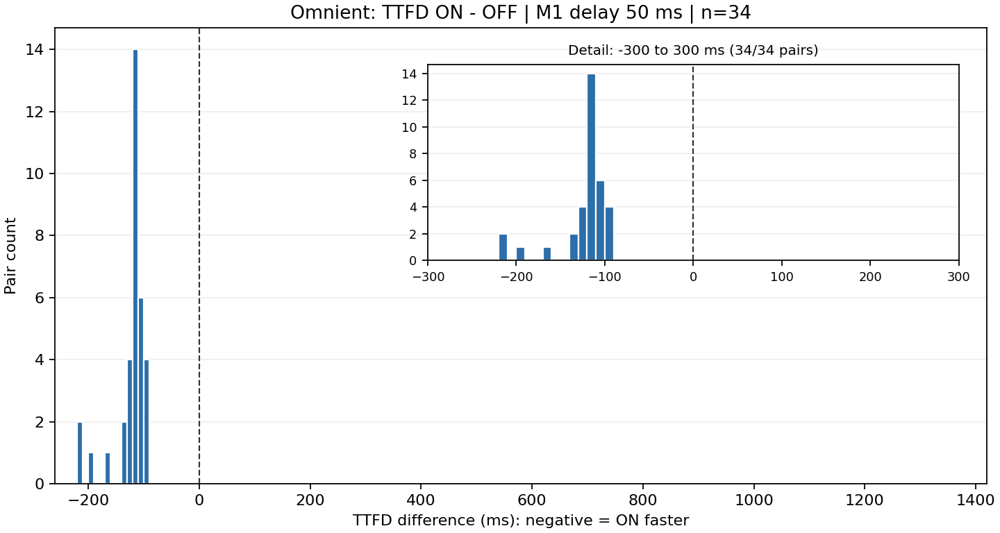
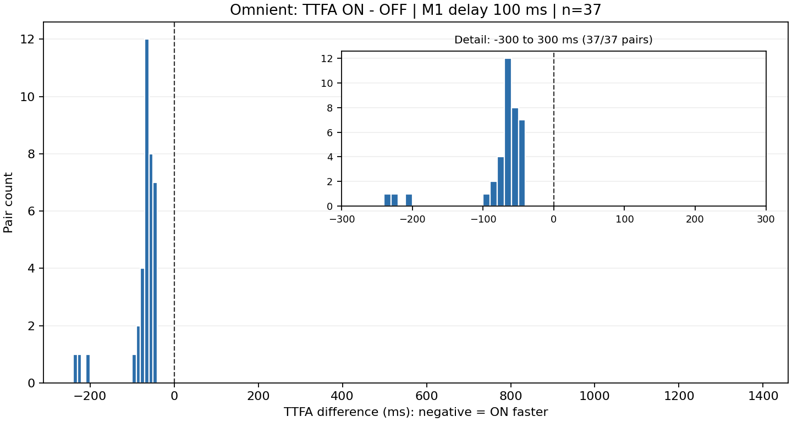
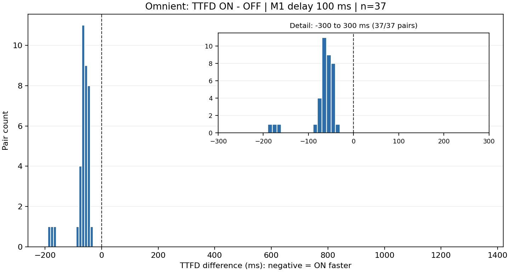
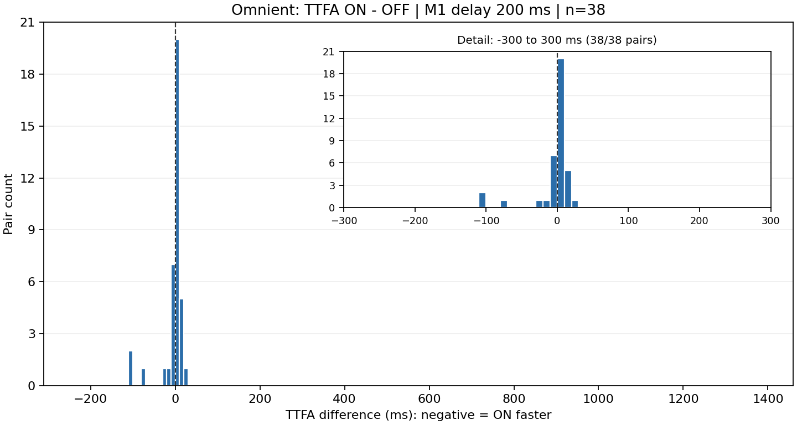
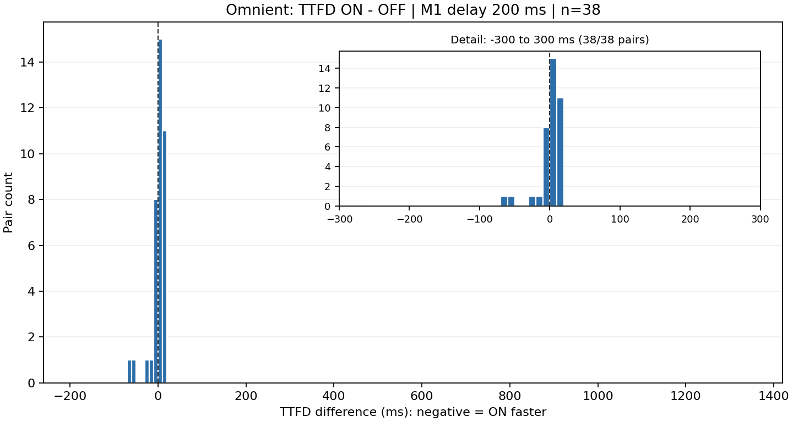

# Lens benchmark — Omnient delay sweep including early POST HTTP 400 pairs

## Experiment specification

[Google net_http: Lens Latency Mimic & Shutter Benchmark Mode](https://github.com/google/net_http/blob/main/webchannel/objc/demo/WebChanneliOSDemo/DESIGN.md#d-lens-latency-mimic--shutter-benchmark-mode).

## Environment

| Field | Recorded value |
|---|---|
| Device | iPhone SE (3rd generation), hardware model `iPhone14,6` |
| iOS | 26.3.1, from XCTest |
| Network switches | Not independently recorded for this run |
| Endpoint | `https://webchannel.sandbox.google.com/staging/channel/lens` |
| Mac | macOS 26.5.1; Xcode 26.6; Build version 17F113 |
| Source | Git HEAD `21eee148acc4a2bcb9856adc5ba9d7463a33f84d` plus uncommitted benchmark instrumentation |
| Test period | 0 ms: 2026-10-12 14:10–14:17 JST, from artifact timestamps; 50 ms: 2026-10-12 14:17–14:52 JST, from artifact timestamps; 100 ms: 2026-10-12 14:56–15:03 JST, from artifact timestamps; 200 ms: 2026-10-12 15:03–15:27 JST, from artifact timestamps |
| Test execution | 50 alternating OFF/ON pairs per delay; 0, 50, 100, 200 ms in that order; a separate `xcodebuild test-without-building` invocation for each trial |
| Test result | 400/400 completed trials; 400/400 passed fresh-transport verification |
| Transport requirement | First transport: `h2`, a new TCP/TLS connection on the handshake GET/POST or early POST; if the GET reused the early POST connection, matching address and local port |

## Procedure and parameters

1. Build the XCTest bundle once, then launch exactly one cold-trial test method per `xcodebuild test-without-building` invocation. Keep parallel testing disabled and retain each `.xcresult` bundle.
2. Run Omnient. Each pair runs `fastHandshake2=false` (OFF), then `fastHandshake2=true` (ON). The XCTest creates a new `WebChannelService` and WebChannel client per trial.
3. Use `imageSizeKb=150`, `detectionDelayMs=50`, `initialMessageDelayMs=0, 50, 100, 200` (separate settings), `enableBinaryEncoding=true`, `sendRawJson=true`, `fastHandshake=false`, `nonBlockingSend=false`, `blockingHandshake=false`, `forceLongPolling=false`, and `detectBufferingProxy=false`. The 150 KB value is metadata; no 150 KB image is uploaded.
4. Schedule M1 Sticky Cluster Info at the configured delay after `connect()` returns. Omnient sends M3 Prefetch immediately after M1. M4 Final Capture follows preliminary detections. Each trial has a 60-second completion deadline.
5. Record Handshake (`webChannelOpened` minus connect), TTFA (M3 send to stream ACK), TTFD (M3 send to preliminary detections), and M4 RTT (M4 send to interaction response).
6. Include a pair in the histograms only if both runs completed, both trials meet the transport requirement, and the absolute ON/OFF handshake-duration difference is ≤20 ms. Calculate that difference from full-precision values. Keep every trial in the raw attachments and audit.

7. Include pairs whose ON initial early POST returned HTTP 400, including trials completed after retry. The completion, fresh-transport, and 20 ms handshake-difference conditions still apply. An unresolved early POST status remains excluded; a verified absence of an early POST is eligible. No additional measurements were run.
8. Plot paired differences as ON minus OFF, using full-precision measurements. Negative values mean ON was faster. All four delay settings use the same horizontal range and bin edges for each metric. Histograms use 10 ms bins aligned to multiples of 10 ms, pair counts on the vertical axis, and all eligible values without clipping in the main plot. When the full range exceeds 600 ms, an inset magnifies -300 to 300 ms and labels the number of pairs in that range; no additional pairs are excluded. TTFA and TTFD are measured from M3 send, so the configured M1 delay is not added to either metric.

## Pair inclusion and early POST rejection

The HTTP 400 rate uses all 50 attempted pairs at each delay as the denominator, including pairs that fail other histogram inclusion conditions.

| M1 delay (ms) | Measured pairs | ON early POST HTTP 400 | 400 pair rate | No early POST | Unresolved status | Histogram pairs |
|---:|---:|---:|---:|---:|---:|---:|
| 0 | 50 | 29 | 58.0% | 0 | 0 | 35 |
| 50 | 50 | 3 | 6.0% | 0 | 0 | 34 |
| 100 | 50 | 0 | 0.0% | 0 | 0 | 37 |
| 200 | 50 | 4 | 8.0% | 43 | 0 | 38 |

| M1 delay (ms) | HTTP 400 pairs included in histograms |
|---:|---:|
| 0 | 18 |
| 50 | 0 |
| 100 | 0 |
| 200 | 0 |

## M1 delay: 0 ms

### TTFA: ON minus OFF

### TTFD: ON minus OFF

## M1 delay: 50 ms

### TTFA: ON minus OFF

### TTFD: ON minus OFF

## M1 delay: 100 ms

### TTFA: ON minus OFF

### TTFD: ON minus OFF

## M1 delay: 200 ms

### TTFA: ON minus OFF

### TTFD: ON minus OFF

