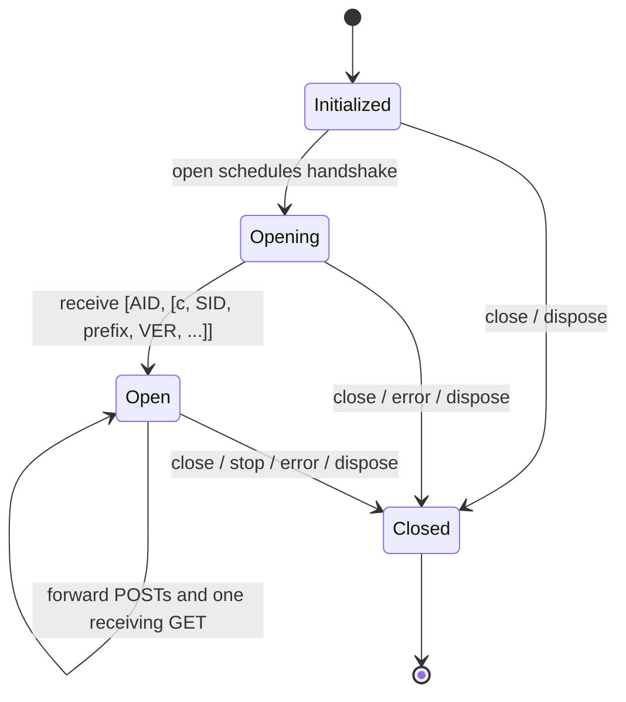

# WebChannel JavaScript / TypeScript code map

The active client is the Closure-independent TypeScript implementation in
`src/`. It implements the v8 HTTP wire protocol from `imported_src/` using native
XHR or Fetch, standard URL/JSON/collection APIs, and a local event dispatcher.
There are no runtime npm dependencies. Distribution uses tsdown (Rolldown)
with TypeScript for declarations and separate type checking. The browser demo
uses Vite, installed in its own package.

The imported sources remain the input to a separate, maintained Closure build,
which writes `dist/`. The original bundle is archived in
`test/fixtures/webchannel_blob_original.js` for regression comparisons. Neither
Closure artifact is an input to the TypeScript build.

## Layout and build paths

| Path | Role |
| --- | --- |
| `src/index.ts` | Package entry point and public exports |
| `src/types.ts` | Options, messages, native XHR factory, runtime properties |
| `src/webchannel.ts` | Public channel, handshake, forward/backchannel state, retry and shutdown |
| `src/request.ts` | One HTTP operation, watchdog, incremental XHR/Fetch receive, best-effort termination |
| `src/wire.ts` | v8 message maps, queue offsets and incremental length-prefixed framing |
| `src/pool.ts` | Forward request pool: one slot initially, configurable multiplexed limit |
| `src/events.ts` | Typed `listen` / `listenOnce`, listener removal and disposal |
| `src/stats.ts` | Shared statistics target, reachability and timing events |
| `src/network.ts` | Network diagnostic probe after a request failure |
| `lib/` | Ignored tsdown output: ESM modules, generated declarations, source/declaration maps |
| `tsdown.config.ts` | Distribution build: ESM only, ES2022, neutral platform, preserved module boundaries |
| `test/` | Legacy comparisons, deterministic protocol/lifecycle tests, Fetch and real HTTP tests |
| `demo/message_generator.ts` | Browser demo importing `src/index.ts`; bundled by Vite |
| `demo/vite.config.mts` | Vite dev/build/preview configuration with relative asset paths |
| `demo/dist/` | Ignored, complete static site: built HTML plus hashed assets; deploy its contents |
| `dist/webchannel_blob_es2022.{js,d.ts}` | Rebuilt Closure bundle and historical hand-written declarations |
| `test/fixtures/webchannel_blob_original.js` | Original bundle, archived unchanged as the comparison baseline |
| `test/fixtures/legacy-demo/demo.js` | Archived browser demo IIFE with embedded historical Closure client; reference only |
| `imported_src/` | Imported Closure implementation and its original test sources |
| `compile.js`, `exports.js` | Maintained Closure compiler configuration and public API entry, isolated from the default TS build |
| `legacy/package{,-lock}.json` | Pinned dependencies for the Closure build |
| `legacy/externs.js` | Public options, events and XHR factory externs |
| `legacy/check.cjs` | Checks the rebuilt Closure bundle against the original API and shared protocol suites |
| `legacy-build/` | Ignored leftovers from earlier compiler experiments |

Building with the pinned tsdown requires Node.js `^22.18.0 || ^24.11.0 ||
>=26.0.0` and npm 11.17+. This is a development-tool requirement; the generated package
still supports Node `^22.13.0 || >=24.0.0` at runtime. A current Node 26 release
is used in the Pages workflow. To build and test the library:

```sh
cd webchannel/js
npm run deps:install
npm run build
npm run typecheck
npm test
```

`npm test` builds the library and runs all tests, including an HTTP peer bound to
an ephemeral port on `127.0.0.1`. It needs permission to start local processes
and bind a local socket. Tests do not contact a remote WebChannel service.
`make build`, `make test` and `make typecheck` are aliases. `make clean` removes
`lib/` and `legacy-build/`, preserving `dist/` and the archived original bundle.

The library emits ES2022 JavaScript. Its default HTTP implementation needs a
native `XMLHttpRequest`. Set `useFetchStreams: true` to use native Fetch,
ReadableStream, TextDecoder and AbortController, including in Node.js. An
`xmlHttpFactory` with `createInstance(): XMLHttpRequest` takes precedence over
Fetch, matching the original option. No Closure factory class is needed.
Browser applications can bundle the TypeScript sources or the ESM output.

## Browser compatibility assessment (2026-11-25)

The browser support target follows Vite's 2026-01-01 Baseline browser set:
Chrome 111+, Edge 111+, Firefox 114+, Safari/iOS 16.4+. This is a fixed project
target, not a claim that every minimum-version engine has been tested. The
library retains `target: ES2022`; the demo's Vite configuration explicitly targets
those browsers. The general Closure compatibility layer remains removed, with
one small, targeted `Symbol.dispose` polyfill retained for API compatibility.

### What actually disappeared

The compiler's [polyfill injection](https://github.com/google/closure-compiler/wiki/Polyfills)
and the Closure Library's fallbacks are separate mechanisms. Their availability
in the toolchain does not imply that every fallback was included or active in
this particular bundle.

The archived original `test/fixtures/webchannel_blob_original.js` has exactly one
`$jscomp.polyfill("...", ...)` registration: `Symbol.dispose` (line 232). It
also has compiler runtime helpers for construction/prototypes, generators and
async context, and the polyfill registration machinery itself. It does **not**
register polyfills for `Promise`, `Map`, `Set`, `globalThis`, `Array.from` or
`Object.entries`. Those values were already expected to be supplied by the
runtime or host application. Its `$jscomp.ASSUME_ES2020` is true and its emitted
code uses `globalThis`, native Promise/collections and modern syntax. Presence
of IE-related constants elsewhere in the bundle does not make it an IE build.
The maintained `compile.js` separately targets ECMASCRIPT_2021; its rebuilt
artifact is not a substitute for inspecting that original baseline.

| Removed facility | Assessment |
| --- | --- |
| Compiler runtime helpers and the polyfill registry | No direct replacement needed for the new implementation's native classes, async functions and built-ins on the browser target |
| `goog.async` scheduling fallbacks and assorted older event/DOM/UA helpers | Native `queueMicrotask` and the local event dispatcher suffice on that set. The checked-in bundle's actual `goog.async.run` already uses `Promise.resolve`; the older library source's conditional fallback is not its emitted behavior |
| XHR compatibility branches such as `mozResponseArrayBuffer`, IE status constants, guarded legacy property access | No need to reproduce obsolete engine behavior for the target set. WebChannel still expects HTTP 200; a generic XhrIo success-status list is not the channel protocol |
| Chrome `loadTimes().wasFetchedViaSpdy` detection | Removing it can leave concurrency at one until handshake headers arrive; it does not remove the transport. The new pool still detects navigation protocol information and server wire-protocol headers |
| `Symbol.dispose` injection and inherited disposal method | Restored in the local EventTarget base, including one shared-symbol polyfill when absent; see below |

The old public channel inherits `[Symbol.dispose]()` from `goog.Disposable`,
in addition to `dispose()`. The port restores this method on its EventTarget
base and implements TypeScript's `Disposable` interface. The method calls
`this.dispose()` virtually, so the WebChannel override cancels its requests
and listeners. Repeated disposal is safe; it does not emit CLOSE, just like
calling `dispose()` directly.

When the module loads, an existing `Symbol.dispose` and its property descriptor
are preserved. If the symbol is absent, the module defines a non-enumerable,
writable, configurable property with `Symbol('Symbol.dispose')`, matching the
old compiler's targeted polyfill. All copies using that realm's Symbol object
reuse the same key. No native `Symbol.dispose` support is required by the
browser target. Native availability is still limited according to
[MDN](https://developer.mozilla.org/en-US/docs/Web/JavaScript/Reference/Global_Objects/Symbol/dispose).

The generated `events.d.ts` preserves a reference to TypeScript's
`esnext.disposable` declarations, so consumers can use the canonical
`Disposable` type without adding that lib manually. TypeScript 5.2+ understands
`using`; applications targeting the browsers above should transpile it rather
than shipping native `using` syntax. No `DisposableStack`, `Symbol.asyncDispose`
or async-disposal runtime is installed by this library.

```ts
import {createWebChannelTransport} from './src/index';

function run() {
  using channel = createWebChannelTransport().createWebChannel('/channel');
  channel.open();
  // Synchronous scope exit calls dispose(), including on an exception.
}
```

This is immediate resource cleanup, not a wait for delivery: asynchronous work
needs an appropriately long-lived scope, and unsent messages are not flushed
by disposal.

### Requirements of the port

[TypeScript's `target`](https://www.typescriptlang.org/tsconfig/target.html)
controls syntax lowering; [`lib`](https://www.typescriptlang.org/tsconfig/lib.html)
selects declarations. Neither configuration installs runtime polyfills.
Lowering `target` alone does not supply missing Web APIs, and adding
`browserslist` alone would not change this `tsc` build.

| Path | Required facilities / treatment |
| --- | --- |
| All channels | ES2022 output syntax, including public/static class fields; optional chaining and logical assignment; `globalThis`, `Map`, `Set`, JSON, `Object.entries`/assign, `Array.find`/flatMap, `Number.isSafeInteger`, `URL`/`URLSearchParams`, timers and `queueMicrotask` |
| Default XHR / custom XHR factory | Streaming `responseText`, standard ready-state/error handling, headers and credentials; Fetch/Streams/TextDecoder/AbortController are not required merely to use this path |
| `useFetchStreams: true`, without a custom XHR factory | Fetch with readable response bodies and default stream readers, cancellation, streaming `TextDecoder`, `AbortController`, Promise and `Object.fromEntries`; a fetch-shaped buffered polyfill is not sufficient evidence of streaming compatibility |
| `networkTestUrl` diagnostic option | Also needs Fetch and AbortController even when normal requests use XHR; this is a diagnostic request, not the channel transport |
| Termination | `sendBeacon` is optional and retains image/HTTP fallbacks. Delivery after unload remains best effort regardless of browser age |
| Navigation timing / wire protocol detection | Performance timing is optional; the server handshake can enable multiplexing |

Public class fields, logical assignment, queueMicrotask and default stream
readers are already widely available according to the respective MDN pages:
[class fields](https://developer.mozilla.org/en-US/docs/Web/JavaScript/Reference/Classes/Public_class_fields),
[logical assignment](https://developer.mozilla.org/en-US/docs/Web/JavaScript/Reference/Operators/Nullish_coalescing_assignment),
[queueMicrotask](https://developer.mozilla.org/en-US/docs/Web/API/Window/queueMicrotask),
[stream readers](https://developer.mozilla.org/en-US/docs/Web/API/ReadableStream/getReader).
`Symbol.dispose` is not needed for normal open/send/close/dispose operation.
The port does not implement BYOB readers or streaming uploads, so those newer
capabilities must not become accidental requirements in feature detection.

### Ecosystem comparison and support target

Current [Vite production builds](https://vite.dev/guide/build) use a dated
Baseline Widely Available target; its [build configuration](https://vite.dev/config/build-options)
lists Chrome 111+, Edge 111+, Firefox 114+, Safari/iOS 16.4+ for the 2026-01-01
baseline. [Angular](https://angular.dev/reference/versions) likewise adopts dated
Baseline browser sets. These support a bounded modern-browser policy, rather
than carrying every historical compatibility path indefinitely.

This is not universal permission to drop every polyfill: [Firebase](https://firebase.google.com/docs/web/environments-js-sdk#polyfills)
places responsibility for older environments' polyfills on the application,
while [Vue 3](https://vuejs.org/about/faq#what-browsers-does-vue-support)
uses a different, older ES2016 browser requirement and excludes IE11. Support
policy, syntax output and runtime API requirements must be stated separately.

For this port, the adopted support target is the concrete Vite browser set
above, including corresponding iOS/WKWebView and Chromium Android WebView
engines. Embedded WebViews should be judged by their actual engine,
not an assumption that their host OS or app is recent. IE11 and EdgeHTML are
outside this target. The code's current syntax and API usage do
not indicate a need for general polyfill injection on that set; this is a
static assessment, not a browser certification.

Remaining browser validation is real XHR and Fetch against the minimum engines
(or documentation of unavailable historical engines), plus current stable
browsers. It should cover streaming, long polling, header handshake,
cancellation, CORS and lifecycle events. Node/VM tests do not certify browsers.

Keep general polyfills an explicit host-application choice for older targets;
a generic Fetch or core-js bundle does not guarantee native streaming, abort
semantics or unload delivery. The disposal-key polyfill above is a deliberate
exception to preserve the public cleanup protocol. Advance the dated support
target deliberately, normally with a major release.

## Public API and migration

Import from the package (or `src/index.ts` when bundling sources). Package
`exports` routes both ESM `import` and CommonJS `require()` to the **same ESM
implementation** in `lib/index.js`, with generated types in `lib/index.d.ts`.
`main` and `types` retain those same paths for tooling. The package does not
ship a second CJS implementation. CommonJS consumers rely on Node's synchronous
ESM loader. Supported Node versions are `^22.13.0 || >=24.0.0`; this is independent
of the browser support target. Node 20 and earlier, Node 23, and older CJS-only
toolchains are outside this package's support policy.

For CommonJS on a supported Node version:

```js
const {createWebChannelTransport, WebChannel} = require('webchannel-js');
```

The library and all its dependencies must remain free of top-level `await` to
preserve synchronous `require()` support. Async functions and async HTTP
operations are unaffected. Loading the same installed package via both APIs
shares classes and the statistics target; this avoids splitting listeners across
two separately compiled implementations. It does not merge multiple installed
copies or copies bundled by an application.

TypeScript consumers should use a Node module mode that models `require(ESM)`,
such as TS 5.8+ `nodenext` or TS 5.9+ `node20`; browser applications can use
bundler resolution. `node16`/`node18` modes may reject a CJS-to-ESM import even
on a newer Node runtime. Source type checking uses `NodeNext` with explicit `.js` relative imports.
`tsdown.config.ts` generates ESM and declarations in unbundle mode, preserving
source module boundaries and the same public package entry. JS and declarations
resolve without a consumer bundler; Vite bundles the demo for deployment.

Only the package root and `package.json` are public package exports. Historical
deep package imports must migrate to the root. Direct repository paths into
`dist/webchannel_blob_es2022.js` still select the maintained Closure
implementation, which is outside the package's published files. `dist/` and
`test/fixtures/` each have a CommonJS package scope so the legacy `.js` bundles
retain their original interpretation despite the root's `type: module`.
The demo already uses the new implementation.

`npm pack` runs `prepack` to build ESM and declarations with tsdown before
packaging. The archive includes `lib/`, `src/` and the package README, with no tests, Closure
dependencies or legacy bundles. Source maps and declaration maps point back to
the included sources. There is deliberately no blanket `sideEffects: false`: the
`Symbol.dispose` installation must survive consumer bundling. See also the
[package README](README.md).

```ts
import {createWebChannelTransport, WebChannel} from 'webchannel-js';

const channel = createWebChannelTransport().createWebChannel('/channel', {
  sendRawJson: true,
  useFetchStreams: true,
  httpSessionIdParam: 'gsessionid',
});
channel.listen(WebChannel.EventType.MESSAGE, event => console.log(event.data));
channel.listen(WebChannel.EventType.ERROR, event => console.log(event.errorCode));
channel.open();
channel.send({message: 'hello'});
// channel.close() or channel.dispose() when finished
```

The historical exports `createWebChannelTransport`, `getStatEventTarget`,
`Event`, `Stat`, `ErrorCode`, `EventType`, and `WebChannel` are retained. In
particular, the channel event strings remain `a` / `b` / `c` / `d`, and error and
statistic numbers remain unchanged. `WebChannel.EventType` is distinct from the
HTTP `EventType` export. New declarations come from the implementation instead
of the old, incomplete hand-written `.d.ts`. Event callbacks infer message,
error or statistic fields from their event type.

`send()` accepts strings and objects, including `Map<string, unknown>` in map
mode. Strings use `__data__`; `sendRawJson` serializes objects into `__data__`.
Otherwise object fields are v8 map fields, with nested values serialized as
JSON. The public `MESSAGE` event preserves the original array/object payload,
`__headers__` / `__status__`, and single-metadata `__sm__` interpretation.

The local dispatcher provides `listen`, `listenOnce`, `unlisten`,
`unlistenByKey`, `removeAllListeners`, `addEventListener`, `removeEventListener`,
and `dispose`, plus `[Symbol.dispose]()` for explicit resource management.
It replaces the event subscription surface used by this client;
it does not implement Closure's parent event-target propagation or external
`goog.events` listener registry. Listeners run synchronously, and transport
processing isolates application callback exceptions. `dispose()` releases
listeners and requests without a CLOSE event, as in the imported wrapper.

`getRuntimeProperties()` exposes concurrency, pending requests, unacknowledged
messages/gap, HTTP session routing, last failure status/headers, and the original
one-shot `commit(callback)` acknowledgement notification. `commit` is not a
server-side application transaction or a promise that every queued message was
processed by the application.

## Protocol and lifetime



- Handshake: POST `VER=8`, `CVER=22`, `RID`, with an optional initial batch.
  Blocking mode adds `TYPE=init`. Fast handshake sends `$req` in a GET with
  `SID=null`, decodes `X-HTTP-Initial-Response`, and keeps that GET as the
  backchannel. Initial raw data is capped at 4096 JavaScript characters and
  respects `maxMessagesPerRequest`.
- Sending: `count`, `ofs` and `req<ID-offset>_<field>` preserve v8 message IDs.
  A normal request adds `SID`, `RID`, `AID`, `t` and a cache buster. A retry
  retains its RID and message IDs and increases the attempt number. Default
  forward retry limit is two; the handshake is not retried. Multiple failed
  requests can coalesce into an already scheduled send, as in the original.
- Receiving: one GET carries `RID=rpc`, `SID`, `AID`, `CI` and `TYPE=xmlhttp`.
  Chunks use `<length>\n<JSON>`; length counts UTF-16 code units, not UTF-8
  bytes. Fetch uses a streaming UTF-8 decoder before framing. Completed Fetch
  chunks are discarded instead of accumulating the entire response. Duplicate
  and older array IDs are ignored; gaps are accepted, matching the imported
  code. A fresh backchannel carries the last delivered AID.
- HTTP/1 starts with one forward slot. Navigation protocol information or the
  server's `X-Client-Wire-Protocol` can enable the configured limit (default 10).
  SPDY, h2 and QUIC are supported, with explicit h3 recognition added.
- POST acknowledgement triples can report a missing backchannel or outstanding
  server data. Missing or apparently dead receiving requests are restarted
  using the original 3-second RTT / 6-second dead-channel thresholds and
  37,500-byte cutoff. Failed receiving requests have a three-retry limit.
- The request watchdog starts at 45 seconds; normal POSTs use the configured
  forward timeout with 50–100% jitter. A handshake keepalive interval sets the
  backchannel timeout to 1.5 times that interval. Received partial data resets
  the watchdog. Retry delays use the original linear backoff and jitter;
  the first retry is immediate. The public wrapper is always active, so the
  internal Handler's inactive-channel multiplier is unnecessary here.
- Buffering detection waits four handshake RTTs for the first receiving bytes.
  A timeout cancels streaming and starts long polling (`CI=1`), optionally
  adding `TO`. Successful detection emits `NOPROXY`. Detection remains disabled
  with fast handshake, as in the original.
- Headers, body/query header overrides, mutable message headers and URL params,
  credentials, secondary-domain backchannels, and HTTP session routing are
  supported. Termination is best effort: beacon, image, or a native HTTP
  request. It cannot guarantee delivery after a page has gone away.
- Closing cancels microtasks, retry/detection timers, watchdogs, XHRs, Fetch
  controllers and stream readers, and retains a snapshot of unacknowledged
  messages. Close is idempotent. Reopening the same object is rejected; create
  another channel. Reentrant close/dispose from OPEN or MESSAGE stops further
  processing, including later messages from the same frame.

## Imported source correspondence

| Historical source | TypeScript replacement / disposition |
| --- | --- |
| `channel.js` | Typed `RequestObserver`, options and runtime interfaces; the internal Closure extension interface is not public |
| `webchannelbase.js` | State machine and scheduling in `webchannel.ts` |
| `webchannelbasetransport.js` | Public class, message/error events and runtime properties in `webchannel.ts` |
| `channelrequest.js` | Native request, framing integration, watchdog and termination in `request.ts` |
| `wire.js`, `wirev8.js` | Typed codec and queued messages in `wire.ts` |
| `forwardchannelrequestpool.js` | Native Set-based pool in `pool.ts` |
| `requeststats.js` | Shared typed event target and the same event constants in `stats.ts`; Closure execution hooks were internal and are not exposed |
| `netutils.js` | Bounded diagnostic probe in `network.ts`, with single completion on timeout |
| `connectionstate.js` | Unused legacy handshake/buffering-result container; active fields live directly on the channel |
| `environment.js` | No replacement: expired origin-trial code was disabled by the imported build's `ALLOW_ORIGIN_TRIAL_FEATURES=false` |
| `webchanneldebug.js` | No Closure logger or payload logging; `disableRedact` is accepted but has no effect |
| `testing/fakewebchannel.js` | Retained reference mock; current tests inject native XHR/Fetch and exercise the actual protocol |
| `tests/*` | Original Closure/Jasmine suites retained; not runnable via the new npm test command and not counted as port validation |

`halfClose()` remains unimplemented and throws. `requestRefreshThresholds` was
already unused in `imported_src`; it is accepted but has no effect. Binary wire
encoding, reconnection of a closed channel, and the internal Closure Handler
extension API are not added by this port. `enableOriginTrials` is inert.
`disableRedac`, the typo in the historical declarations, is deprecated.

Intentional changes beyond replacing dependencies: malformed/non-array JSON,
invalid envelope/acknowledgement shapes and invalid chunk sizes fail cleanly;
negative, fractional or infinite chunk sizes cannot spin the parser. An
unsupported negotiated protocol version is rejected. Invalid concurrency/batch
limits are rejected. Pending retry messages remain visible to runtime queries;
raw strings remain queryable when `sendRawJson` is enabled;
shutdown from event callbacks cannot restart networking. Native URL resolution
is used for relative endpoints. These are not claims of byte-identical output
or of identical behavior on malformed server input.

## Historical compilation attempt

History records `bd0461ea` as
`feat(webchannel/js): make the Closure code compilable (not working yet)`.
That change introduced `compile.js`, `exports.js`, the package files, Makefile
and build notes. The existing `dist/` came from an earlier change. Its precise
original compiler invocation is not recorded here; the later script does not
reproduce it.

The original bundle is a readable Closure-generated IIFE with CommonJS
exports. It includes both WebChannel and bundled Closure infrastructure, plus
explicit preservation of public method names. The original PR #76 script used
ADVANCED optimization but protected only top-level export keys. It compiled
successfully while losing `transport.createWebChannel` and
`WebChannel.EventType` under their public names. The maintained build below
replaces that incomplete configuration.

Build the Closure implementation independently of the default TypeScript build:

```sh
npm run deps:install --prefix legacy
npm run build:legacy
npm run test:legacy
# Output: dist/webchannel_blob_es2022.js
```

The dependencies resolve under `legacy/node_modules`. `build:legacy` overwrites
the tracked Closure JS bundle; it leaves its historical hand-written `.d.ts`
unchanged. `npm run build` continues to emit the TypeScript port to `lib/`.
The original JS is archived unchanged in
`test/fixtures/webchannel_blob_original.js`; all default legacy comparisons
load that snapshot, so replacing `dist/` cannot silently replace the baseline.

### PR #76 rebuild experiment (2026-11-25)

[PR #76](https://github.com/google/net_http/pull/76) introduced the compilation
attempt; its merged revision is `bd0461ea`. The reference bundle was added
separately in `5d0557ab` ([PR #72](https://github.com/google/net_http/pull/72)).
Neither PR's description/comments supplies its original compiler invocation
or complete input revisions.

The API-preserving profile was verified and then promoted to the standard
`compile.js` / `exports.js` build, replacing `dist/` at the user's request.
`imported_src/` and the default TypeScript entry point remain unchanged. It uses
the pinned compiler 20240317.0.0 and Closure Library 20230802.0.0, with:

- Explicit `goog.exportProperty` bridges and quoted CommonJS/enum exports for
  the externally visible names. Top-level exported object keys alone do not
  preserve instance methods or nested properties under ADVANCED optimization.
- Externs for options, callback event fields and custom XHR factory methods.
  Otherwise `xmlHttpFactory`, for example, is renamed inside the compiled
  implementation and the caller's original property is not recognized.
- `goog.FEATURESET_YEAR=2022` and `goog.json.USE_NATIVE_JSON=true`, matching the
  reference's visible definitions. With the public 2023 defaults, raw JSON
  escapes Unicode differently from the reference's native JSON.stringify.
- A narrow factory adapter: the public 2023 XhrIo requires `getOptions()`, while
  the reference accepts createInstance-only factories. The adapter supplies
  empty legacy options without mutating the caller's factory.
- The reference's disposal protocol, absent from the public 2023 Disposable.
- PRETTY_PRINT formatting. Output language remains ECMASCRIPT_2021, as in PR
  #76; the reference filename's `es2022` suffix does not establish its complete
  compiler configuration.

Measured outputs in this checkout:

| Build | Bytes | Observed result |
| --- | ---: | --- |
| Archived original | 485,922 | Working baseline |
| Original PR configuration / ADVANCED | 14,230 | Public factory method names are not preserved |
| SIMPLE + PRETTY_PRINT | 488,971 | Similar size, but different internals and event values (`open_0` etc.) |
| ADVANCED + debug + PRETTY_PRINT | 59,971 | Debug names do not fix the exported API contract |
| Maintained API-preserving build + PRETTY_PRINT | 82,754 | Matching exported names/constants; shared suites pass |

The rebuilt bundle's SHA-256 is
`7956d36dd443d2ac0810d5cf32484c52020fad76f81817d95b2a3cedaf2884b5`;
the archived original remains
`144ec39824deaff05576bc489c646fa2fba9a3a3637152736f9ef2ddd4974528`.
Two consecutive builds of this profile produced identical bytes.
These are measured sizes/hashes, not similarity scores. The rebuild does not
reproduce the original text, even after pretty printing.

`npm run test:legacy` checks top-level export names, the WebChannel namespace
and enum/header values against the archived original. It then reruns the same
three wire/event, Fetch and disposal suites with the rebuilt `dist/` substituted
for the reference (`WEBCHANNEL_REFERENCE_BUNDLE` in the test harness): **32 tests
passed**. These include comparisons to the TypeScript port and its own disposal
regressions; they are not 32 independent proofs of equivalence between every
branch in the two Closure bundles. The standard suites continue to use the
archived original when that environment variable is unset.

A byte-identical or textually near-identical rebuild is still unestablished.
The reference includes `google3/...` async-context, flags and safevalues modules
and a newer Disposable/XhrIo implementation absent from the pinned public
Closure dependency. Compiler runtime instrumentation and generated annotation
metadata differ too. Formatting and export flags cannot supply those missing
input revisions. For comparison, the public
[closure-net repository](https://github.com/google/closure-net/blob/6f48f578d3e80fe7a85e530a5d95b9351433d135/README.md)
explicitly distributes compiled code; the
[Firebase wrapper build](https://github.com/firebase/firebase-js-sdk/blob/main/packages/webchannel-wrapper/rollup.config.js)
copies/prepares those blobs rather than exposing their full Closure compilation
recipe. This identifies a distribution pattern, not proof that this particular
`dist` was copied from that repository.

Conclusion of the experiment: preserving the declared API and matching the
covered communication behavior is practical with these adjustments. Exact
artifact reproduction needs the original source/dependency revisions,
compiler revision, entry/externs and complete flags/input order. Exhaustive
behavioral equivalence, browser integration and identical original build
provenance have not been established by these tests.

## Validation and remaining coverage

- `test/compatibility.test.cjs` runs the archived original bundle and the new
  compiled implementation in separate VM contexts. The synchronous fake-host
  harness adapts the ESM output to CommonJS in memory using TypeScript; these
  scenarios verify protocol and lifecycle behavior, not native ESM loading. It compares HTTP methods,
  decoded query parameters, POST bodies, headers, credentials and public events
  for maps/Map/raw JSON/strings, header modes, routing, handshake variants,
  long polling, metadata, duplicate IDs, errors, retries and buffering fallback.
  Cache-buster values, query order and empty GET body representation are
  normalized; these tests do not claim byte-identical URLs. A captured non-ASCII
  response from the public echo server also reproduces its framing mismatch
  in both clients.
- `test/protocol.test.cjs` tests malformed frames/responses, every split position
  of Unicode chunks, retry exhaustion, deadlines, cancellation, reentrant
  shutdown, unacknowledged messages, pool limits and mutable options.
- `test/disposal.test.cjs` verifies native/preinstalled and absent disposal
  symbols, shared identity, inherited cleanup, open-request cancellation and
  repeat disposal against the legacy bundle. It compiles `test/fixtures/using.ts`
  against the generated declarations using only ES2022/DOM libs, then executes
  the emitted `using` code on normal and exceptional scope exit.
- `test/fetch.test.cjs` compares Fetch behavior with the legacy bundle and tests
  byte-by-byte UTF-8 delivery, fast header handshake, EOF, cancellation and late
  rejection after close.
- `test/http.test.cjs` uses a real local HTTP peer and native Fetch for normal
  streaming, long polling and fast handshake, including queued initial messages,
  Unicode echoes, session routing and acknowledgements.
- `test/package.test.cjs` packs the ESM output and installs the archive into an
  isolated consumer without registry access. Fresh Node processes load it with
  import-first and require-first order, checking shared class identity, statistics
  delivery and disposal. TypeScript checks ESM and CJS consumer fixtures with
  NodeNext and Node20 modes, plus a bundler consumer, using only ES2022/DOM libs.
  The archive includes source/declaration maps and contains no second CJS build
  or legacy fixtures. This test relies on npm being available.
- `npm run typecheck` checks both the library and the actual browser demo under
  strict TypeScript settings. `npm run build` in `demo/` bundles the new source.

The local HTTP peer is a protocol fixture, not the production server. Browser
XHR is exercised with an injected XHR in the comparison/regression suites.
The [browser validation record](demo/VALIDATION.md) also includes a user-reported
Connect → Send Message → five replies check on Chrome 158.0.8127.37 / Windows 11
26H2, plus six agent-run Playwright checks on Linux Chromium 158.0.8127.18.
The automated checks used real cross-origin XHR against the public generator
and echo endpoints, covering streaming, long polling, map messages,
disconnect/reconnect, multiple echoes and Vite's built output, with no console
or page errors after the CORS header fix. Other engines, minimum browser
versions, browser Fetch/fast-handshake variants, unload/beacon delivery,
HTTP/2 or HTTP/3 negotiation and intermediary buffering still need coverage.

`demo/browser-smoke.mjs` preserves these six scenarios as an optional live test.
Run `npm run test:browser -- --playwright /path/to/playwright/index.mjs` in
`demo/`, following its [setup instructions](demo/README.md#optional-browser-smoke-test).
It manages Vite dev/preview servers, checks browser errors and exits nonzero on
failure. It saves no test artifacts and adds no Playwright dependency or CI job.

On 2026-11-25, the optional native-Fetch smoke test against the demo's public
echo endpoint succeeded for streaming, long polling and fast handshake with an
initial queued ASCII message, both for the TypeScript port and for the original
bundle. The maintained Closure replacement also passed those three live modes
after promotion to `dist/`. Rerun the port and maintained Closure build with:

```sh
npm run test:live
npm run test:live -- --legacy
# Optionally set WEBCHANNEL_ECHO_URL to another compatible echo endpoint.
```

Two live-server limits were observed. A fast handshake with an empty initial
batch did not complete the echo test within 15 seconds in either client;
queuing the initial message succeeded. Also, an unescaped Unicode response
`[[1,{"message":"typescript-port-smoke-雪😀"}]]` arrived with prefix `49\n`,
its UTF-8 byte length, although its UTF-16 length is 45. Both JS clients treat
that frame as incomplete and retry. The port preserves the imported text
framing contract; changing it to count bytes would break servers using the
Closure-compatible UTF-16 framing. The local Unicode tests use the latter
contract. The captured server mismatch is a separate interoperability issue,
not a successful Unicode round trip against that endpoint.

To develop the browser demo:

```sh
cd demo
npm run deps:install
npm run dev
# http://localhost:9000/
```

To produce the complete static site and inspect that output locally:

```sh
npm run build
npm run preview
```

From `webchannel/js/`, `npm run build:demo` is a shortcut for the demo build
(after installing dependencies in `demo/`). Deploy the **contents** of
`demo/dist/`, including its built `index.html` and `assets/`, to a static HTTP(S)
host. The source HTML is Vite's TypeScript entry and is not itself deployable.
`base: './'` makes the generated assets relative so the same build can be served
at `/` or a subdirectory. The Pages workflow copies `demo/dist/.` into
`_site/webchannel/message_generator/`; it no longer copies the source HTML.
No Node application server is required after building. Preview is a local
verification server. The previous `demo/server.js` was replaced by Vite.

`demo/dist/demo.js` was an ignored, stale esbuild-style IIFE embedding the
original Closure bundle and an older demo. Even the checked-in HTML/build
configuration before the TypeScript migration used `dist/message_generator.js`
instead. Both outputs are superseded; Vite cleans `demo/dist/` on a build and
writes the complete site with hashed asset names. The original `demo.js` was
saved unchanged before that cleanup and is permanently archived in
`test/fixtures/legacy-demo/demo.js`. Its source-section comments identify
`../dist/webchannel_blob_es2022.js` and `demo.ts`; the exact historical build
command/version and matching HTML are unestablished. See the
[archive README](test/fixtures/legacy-demo/README.md) for its size/hash and
provenance, and the [demo README](demo/README.md) for current deployment.

### ESM package validation (2026-11-26)

On Node 26.4.0, `npm test` passed all 70 tests, including the packed-package
consumer, native-Fetch local HTTP modes and adapted VM protocol comparisons.
`npm run typecheck`, the demo build, and the 32 shared Closure comparison tests
also passed after the module-format change. On the declared minimum Node
22.13.0, the packed-package test and all three local HTTP modes passed. These
checks exercise both the real Node ESM loader and synchronous require(ESM);
the VM scenarios alone would not establish package compatibility.

Before the Vite migration, a separate `npm pack` check ran the real `prepack`
hook, installed the archive offline, and bundled its public entry with the demo's esbuild for the declared
browser targets, with minification enabled. Executing that bundle in a VM with
no initial `Symbol.dispose` preserved the disposal-key installation and channel
cleanup. This verifies consumer bundling, not real browser network behavior.


### Vite / tsdown migration (2026-11-26)

The pinned tool versions are tsdown 0.23.7 and Vite 8.3.8. tsdown owns
distribution generation, including declarations and both map formats; `tsc`
remains the separate strict type checker. The demo has only Vite as its direct
development dependency. ESM-only distribution with Node require(ESM) support
remains unchanged. Library and demo outputs preserve the Closure copyright and
Apache-2.0 notice. Neither output directory is the archived reference fixture.

After migration, all 70 library tests and all 32 shared Closure comparisons
passed on Node 26.4.0. Strict type checking and both builds passed. The generated
tsdown package passed import/require, consumer typing and all three local HTTP
modes on Node 22.13.0, using output built on Node 26.4.0. Vite dev served the
transformed demo and imported client sources; preview served the built HTML and
JS. Serving the generated HTML under `/some/nested/demo/` on a static HTTP peer
returned HTTP 200 for every referenced asset. These are build/HTTP checks, not
a real-browser WebChannel network certification. The GitHub Pages workflow
configuration was updated but no remote deployment was triggered.


### Dependency policy (2026-11-26)

Each npm project applies `min-release-age=14`, exact direct dependency saves
and `strict-allow-scripts=true`. The checked install command is
`npm run deps:install`; its dependency-free Node checker validates all locked
packages against registry publication times and SHA-512 metadata before
`npm ci`. This closes the observed npm 11.17 behavior that accepts young
versions already present in a lockfile. PR dependency CI and the Pages build
run the check before installation. Unreviewed install hooks fail; the demo
explicitly denies `fsevents@2.3.3`'s optional install hook.

All three trees and a metadata-only latest-tag candidate tree had zero known
vulnerabilities. The age-compliant trees passed 73 library tests, 32 Closure
comparisons, strict type checking and the Vite build. See
[DEPENDENCY_POLICY.md](DEPENDENCY_POLICY.md) for the dated audit, signature
coverage, version choices, the 14-day tradeoff and the update workflow.


### Browser-discovered XHR header fix (2026-11-26)

The automated browser checks found unnecessary single-header probes after
`getAllResponseHeaders`, which emitted Chromium console errors for CORS-hidden
headers despite successful communication. Native XHR now trusts the enumerated
visible headers; single-header lookups are retained only for injected
implementations without enumeration. Both regression tests reproduced the old
behavior and pass after the fix. All 75 Node tests, strict type checking and all
six real-browser scenarios passed. See the [validation record](demo/VALIDATION.md).
